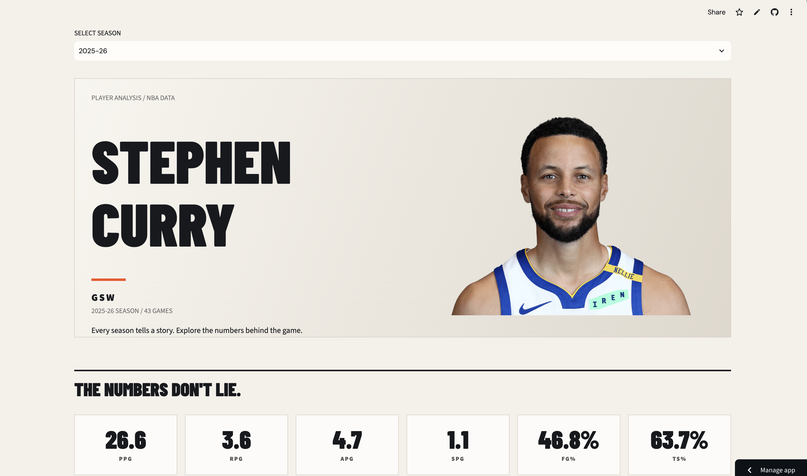
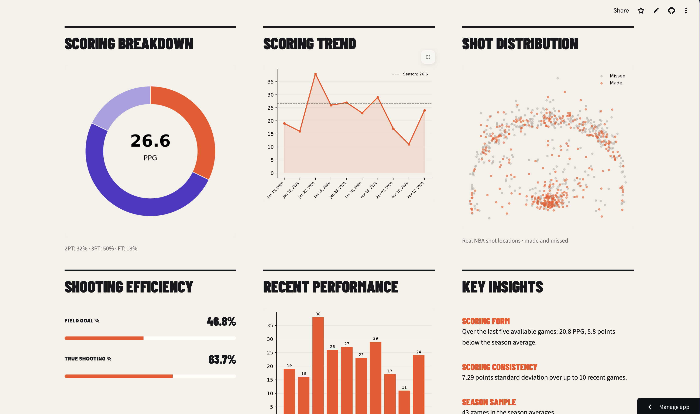
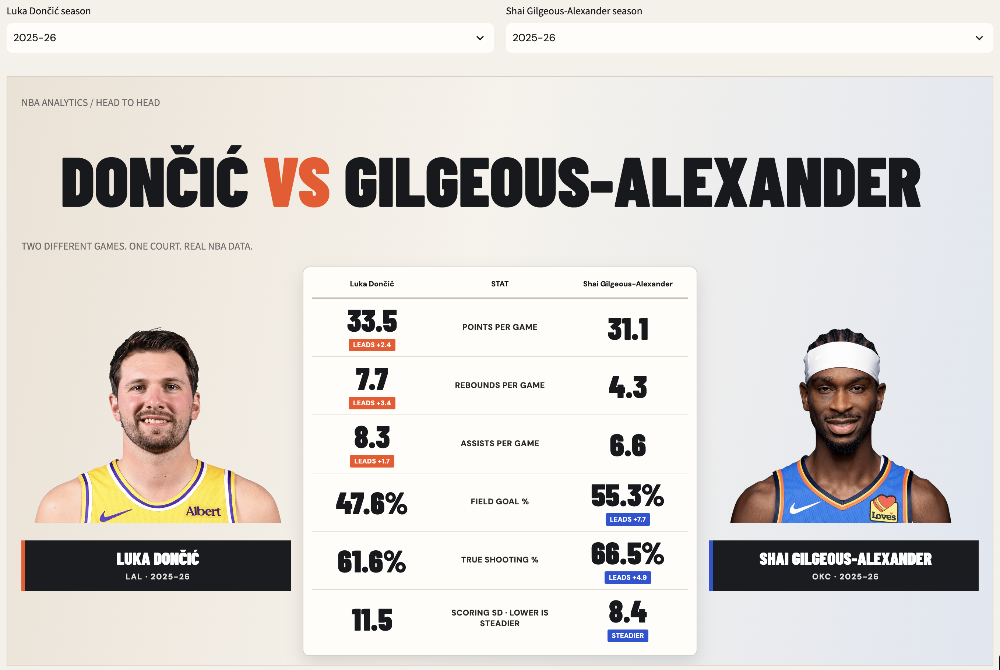
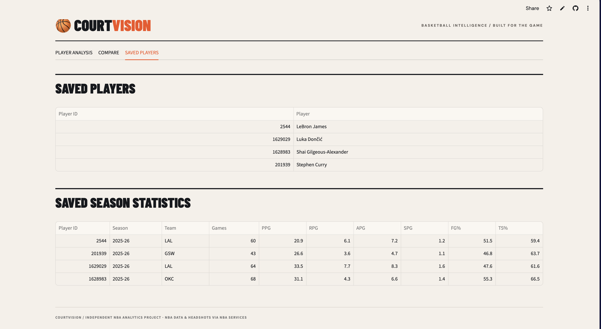
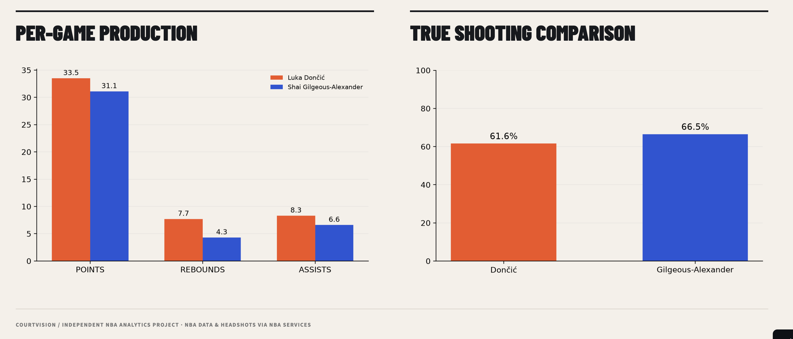

# 🏀 CourtVision


**[🚀 Launch CourtVision — Live NBA Analytics Dashboard](https://courtvision-lshtryw3bfxsvvnhtztyou.streamlit.app/)**

**[View Source Code](https://github.com/Agorochito/Courtvision)**

> **Data note:** The public demo uses an exported snapshot of real NBA statistics. It currently supports seven players and selected seasons. Statistics are historical snapshots, not live updates.


**An interactive NBA player analytics dashboard built with Python, Streamlit, and SQLite.**

CourtVision allows basketball fans and analysts to explore NBA player statistics, evaluate season performance, visualize scoring trends, and compare players through an interactive web dashboard.

The project combines real NBA data with statistical analysis and a basketball-inspired interface.


## Dashboard Preview

### Player Analysis


### Statistical Visualizations


### Head-to-Head Comparison


### Saved Player Statistics



### Saved Player Efficiency



## Features

### Player Analysis
- Search for NBA players by name.
- Select individual NBA seasons to analyze.
- View points, rebounds, assists, steals, field-goal percentage, and true-shooting percentage.
- Explore scoring trends and recent-game performance.
- Visualize scoring breakdowns and available shot-location data.
- Evaluate scoring consistency using standard deviation.
- Generate descriptive performance insights.

### Head-to-Head Comparison
- Compare two NBA players across key performance metrics.
- View official NBA player headshots.
- Compare scoring, rebounding, assists, and shooting efficiency.
- Identify leaders in individual statistical categories.
- Compare scoring consistency over recent games.
- Visualize player differences through comparative charts.

### Saved Player Statistics
- Store player information and season statistics in SQLite.
- View previously analyzed players and their saved season data.

## Technologies Used

| Technology | Purpose |
|---|---|
| Python | Application logic and basketball analytics |
| Streamlit | Interactive web dashboard |
| NBA API (`nba_api`) | NBA player statistics and game logs |
| SQLite | Local player and season-statistics storage |
| Pandas | Data organization and tables |
| Matplotlib | Statistical charts and visualizations |
| NumPy | Numerical calculations and chart support |
| HTML/CSS | Custom basketball-inspired interface |

## Project Structure

```text
Courtvision/
├── .streamlit/
│   └── config.toml
├── app.py
├── main.py
├── styles.css
├── requirements.txt
├── test_consistency.py
├── README.md
└── .gitignore
```

**`app.py`** handles the Streamlit interface, while **`main.py`** manages NBA data retrieval, statistical calculations, and SQLite database operations.

## Running CourtVision Locally

Clone the repository:

```bash
git clone https://github.com/Agorochito/Courtvision.git
cd Courtvision
```

Create and activate a virtual environment:

```bash
python3 -m venv .venv
source .venv/bin/activate
```

Install dependencies:

```bash
python -m pip install -r requirements.txt
```

Launch the dashboard:

```bash
python -m streamlit run app.py
```

Open the local address displayed by Streamlit in your browser.

## How the Analytics Work

**Season averages:** CourtVision calculates per-game production from NBA season totals.

**Recent form:** The application calculates average points, rebounds, and assists across up to five recent games.

**Scoring consistency:** Population standard deviation measures variation in points scored over up to ten recent games. A lower value indicates more consistent scoring, not necessarily better overall performance.

**True shooting percentage:** Shooting efficiency is calculated using field-goal and free-throw attempts.

**Performance insights:** CourtVision compares recent scoring production with season averages to summarize whether a player's scoring is above, below, or equal to their season baseline.

## Testing

The project includes `test_consistency.py` for checking analytical calculations with known test data.

Run:

```bash
python test_consistency.py
```

## Current Limitations

- NBA API availability and response times may affect data retrieval.
- Some historical player portraits or shot-location records may be unavailable.
- The SQLite database is local and is not intended as a permanently shared database when deployed on ephemeral cloud hosting.
- Performance insights are descriptive rather than predictive.

## Future Improvements

- Interactive court-based shot charts.
- More advanced player-comparison analytics.
- Improved historical-season exploration.
- Additional automated tests and API resilience.

## Author

Developed by [Agorochito](https://github.com/Agorochito) as a Python portfolio project focused on data analysis, application development, and basketball analytics.

*CourtVision is an independent project and is not affiliated with the NBA.*